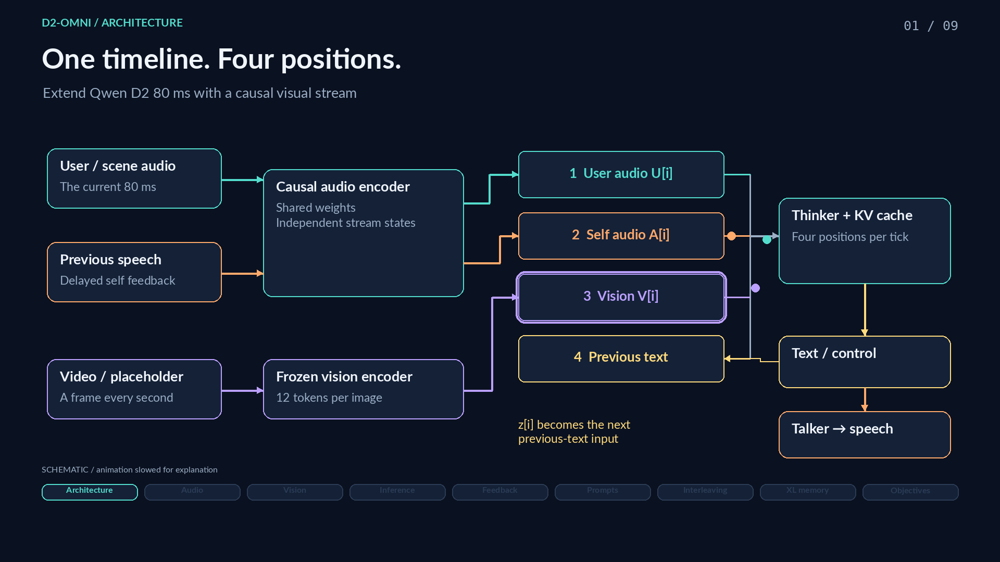

# D2-Omni architecture video

[Watch or download the narrated MP4](d2-omni-architecture.mp4) · [Captions](captions.srt) · [Transcript](transcript.txt)



A **3 minute 33 second**, 1080p animation explaining the implemented Qwen D2
80-ms architecture. It covers the encoders, cached inference calls, task prompts,
training interleaving, and Transformer-XL recurrence. The animation is slowed for
explanation; 80 ms denotes the media clock, not measured wall-clock latency.

| Time | Chapter |
| --- | --- |
| 0:00 | Architecture overview |
| 0:14 | Shared audio encoder with independent user/self stream states |
| 0:36 | Frozen vision encoder and the 12-token visual queue |
| 1:02 | Four-position streaming inference, across successive ticks |
| 1:27 | Talker, waveform rendering, and generated self-audio feedback |
| 1:52 | InstructS2S versus AVQA system prompts and visual inputs |
| 2:15 | Time alignment, interleaving, and teacher forcing |
| 2:42 | 90-second training chunks with 90-second detached memory |
| 3:08 | Text/codec targets, signal timing, and current CE weights |

The MP4 includes chapter markers and burned-in captions. The SRT is also
provided separately. Narration is a synthetic explanatory voice, not a model
inference sample. Actual D2-Omni outputs are in the
[checkpoint-9,000 recordings](../checkpoint-9000/README.md).

## The sequence shown

```text
Stream start:
    [task-specific system-prompt tokens]

Each 80-ms inference tick i:
    [U[i], A[i], V[i]]       three-position cached Thinker prefill
    [z[i-1]]                one cached text step, predicting z[i]
    Talker -> codec frame -> waveform S[i]
    S[i] -> self-audio feedback for tick i+1

Serialized training sequence:
    [system prompt]
    [U[0], A[0], V[0], PAD]
    [U[1], A[1], V[1], z*[0]]
    [U[2], A[2], V[2], z*[1]] ...
```

- `U[i]`: encoded user/environment audio at tick `i`.
- `A[i]`: encoded delayed assistant playback; initially the silence embedding.
- `V[i]`: the next causally available visual token, or the learned visual pad.
- `z[i-1]`: the previous generated text/control token during inference.
- `z*[i-1]`: the previous reference token during training. Text targets are
  read at the fourth position; audio/visual inputs have no text-target loss.
- Talker context follows native response-state routing: text embeddings while
  the Talker is responding, layer-24 hidden context outside that state. Text
  completion does not close an ongoing speech response; codec EOS or INTERRUPT
  does. The streaming session keeps listening after that response closes.

At 1 fps, each independently encoded 96×128 image produces 12 merged tokens and
matching DeepStack features. While video is available, each two-second window
contains 24 real visual tokens and one pad across 25 audio ticks. Missing or
finished video also uses visual padding; padding has no DeepStack injection.

Training concatenates examples from the same task to at least 720 seconds. The
task prompt appears once at the start, not before every tick, chunk, or member
episode. A 90-second chunk contains 1,125 ticks / 4,500 stream positions, with
prompt tokens additional at the start. Keep up to the previous 90 seconds of
detached KV context, backpropagate through the current chunk, and carry the
encoder, previous-text, Talker, codec, and delayed-self state across boundaries.

## Implementation references

The content is checked against the current configuration and the original
task-prompt strings. [sources.json](sources.json) records the source commit,
file hashes, and numerical contract used to build the video.

- [Vision clock and encoder](../../model/vision_stream.py)
- [Original task system prompts](../../model/backbone/d2/prompts.py)
- [Four-position layout and prompt insertion](../../model/backbone/qwen3-omni-D2/model/duplex.py)
- [Streaming inference and feedback](../../model/backbone/qwen3-omni-D2/inference/session.py)
- [Native Talker response transitions](../../model/backbone/qwen3-omni-D2/inference/control.py)
- [Native text/codec training](../../model/backbone/qwen3-omni-D2/model/base.py)
- [XL chunk slicing](../../scripts/xl_data.py) and [training loop](../../scripts/train_omni.py)
- [Current settings](../../configs/train-sls.json)

## Rebuild

The [storyboard](storyboard.json) holds the narration, captions, and exact
prompts. [render_architecture_video.py](../../scripts/render_architecture_video.py)
draws the editable diagrams and animates the token flow. Rendering uses CPU
only, with FFmpeg and the Lato/DejaVu Sans fonts available on the system.

The build used Python 3.12, Piper TTS 1.8.0, ONNX Runtime 1.31.0, NumPy 2.5.4,
and Pillow 13.0.0. Install these in an isolated environment, then run:

```bash
python -m scripts.render_architecture_video \
  --voice /path/to/en_US-lessac-high.onnx
```

Place the corresponding `.onnx.json` file beside the voice. The voice files
come from [rhasspy/piper-voices at the pinned revision](https://huggingface.co/rhasspy/piper-voices/tree/5041a7a49ae5b3a0f30e6837769eb03fdbb231bd/en/en_US/lessac/high).
The [voice model card](https://huggingface.co/rhasspy/piper-voices/blob/5041a7a49ae5b3a0f30e6837769eb03fdbb231bd/en/en_US/lessac/high/MODEL_CARD)
identifies the Lessac/Blizzard 2013 source. Narration uses
[Piper](https://github.com/OHF-Voice/piper1-gpl); the renderer does not redistribute
the voice model or speech engine. Large voice and rendering intermediates stay
in `.cache/`, outside Git.
